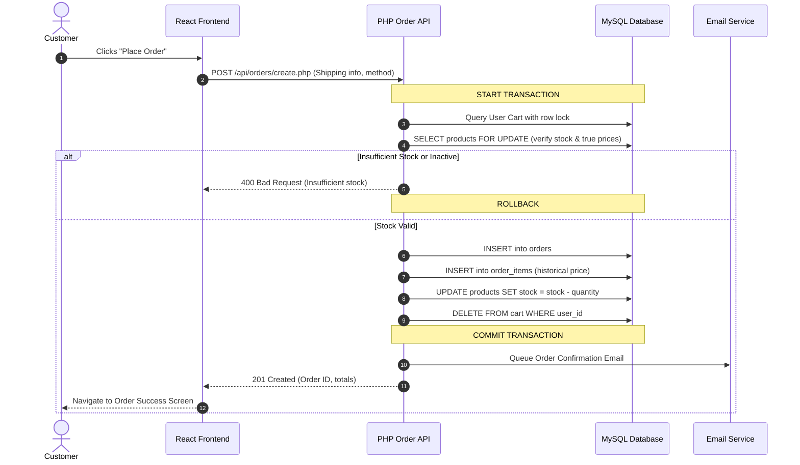
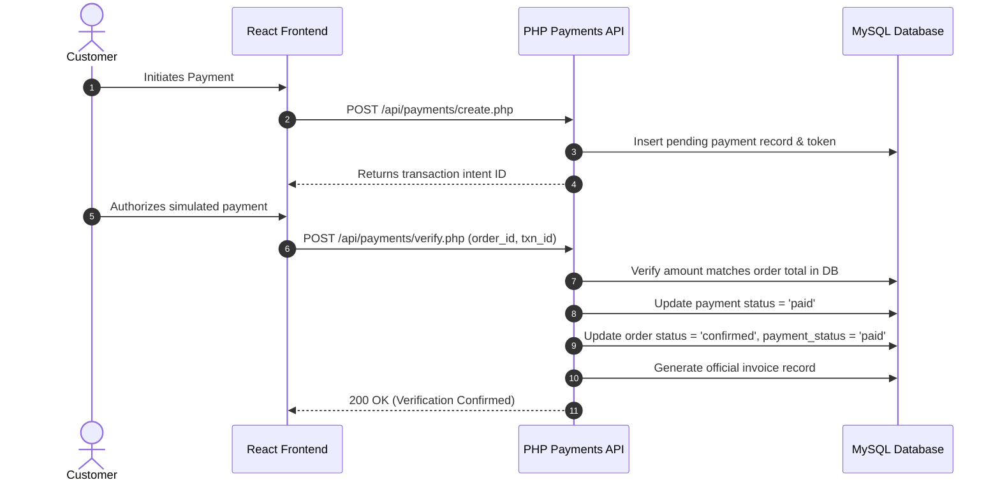

# System Architecture Specification

## 1. Architectural Overview
The **E-Commerce Website – Online Shopping Management System** is designed using a multi-tiered, decoupled client-server architecture. The presentation layer is driven by **React.js 18**, which communicates asynchronously via HTTP/JSON with a lightweight, secure **PHP 8.2 REST API** backend. The persistence layer is managed by **MySQL 10.4 / MariaDB** accessed through PHP Data Objects (**PDO**) using strict prepared statements.

```
                    ┌──────────────────────────────────┐
                    │          CLIENT BROWSER          │
                    │   React 18 SPA + Bootstrap 5     │
                    └─────────────────┬────────────────┘
                                      │ HTTP / JSON (Fetch API)
                                      │ Cookies / Credentials: true
                                      ▼
                    ┌──────────────────────────────────┐
                    │          WEB SERVER TIER         │
                    │     Apache 2.4 / PHP 8.2 Engine  │
                    │                                  │
                    │ ┌──────────────────────────────┐ │
                    │ │       CORS & Session Mgr     │ │
                    │ └──────────────┬───────────────┘ │
                    │                ▼                 │
                    │ ┌──────────────────────────────┐ │
                    │ │      Auth / Admin Filter     │ │
                    │ └──────────────┬───────────────┘ │
                    │                ▼                 │
                    │ ┌──────────────────────────────┐ │
                    │ │       REST API Modules       │ │
                    │ │ (Auth, Products, Cart,       │ │
                    │ │  Orders, Payments, Admin)    │ │
                    │ └──────────────┬───────────────┘ │
                    │                ▼                 │
                    │ ┌──────────────────────────────┐ │
                    │ │      Validation Engine       │ │
                    │ └──────────────┬───────────────┘ │
                    └────────────────┼─────────────────┘
                                     │ PDO Connection
                                     │ (utf8mb4, Prepared Stmts)
                                     ▼
                    ┌──────────────────────────────────┐
                    │          DATABASE TIER           │
                    │      MySQL / MariaDB Engine      │
                    │  InnoDB ACID Transactions        │
                    │  Foreign Key Constraints         │
                    └──────────────────────────────────┘
```

---

## 2. Layered Architectural Decomposition

### 2.1 Presentation Layer (Frontend)
- **Single Page Application (SPA):** Built with React 18, React Router v6, and Vite bundler.
- **State & Session Management:** Centrally handled by `AuthContext.jsx` verifying backend session status with `credentials: 'include'`.
- **UI Framework:** Bootstrap 5 with responsive grid layouts, modal dialogs, and Bootstrap Icons.
- **Decoupled API Client:** Centralized in `services/api.js` ensuring DRY HTTP request handling, response unwrapping, and centralized error catching.

### 2.2 Application / API Layer (Backend)
- **REST-Style Endpoints:** Organized logically by domain entity (`api/auth`, `api/products`, `api/cart`, `api/orders`, etc.).
- **Security Middleware:**
  - `middleware/auth.php`: Inspects `$_SESSION['user_id']`, validates user active status.
  - `middleware/admin.php`: Enforces role-based access control (`$_SESSION['role'] === 'admin'`).
- **Standardized Response Protocol:** All endpoints return consistent JSON wrappers with HTTP status codes:
  ```json
  { "success": true, "message": "Operation successful", "data": {} }
  ```
  ```json
  { "success": false, "message": "Error details", "errors": [] }
  ```
- **Business Logic Layer:** Totals, unit discounts, shipping rules, and payment validations are evaluated solely on the server.

### 2.3 Data Layer (MySQL Database)
- **Storage Engine:** InnoDB supporting full ACID transactions, row-level locking (`FOR UPDATE`), foreign keys with `ON DELETE CASCADE` / `ON DELETE RESTRICT`.
- **Data Integrity:** Historical purchase price persistence via `order_items.price`, ensuring invoice integrity regardless of future price changes.

---

## 3. Core Data & Execution Workflows

### 3.1 Transactional Order Checkout Workflow


### 3.2 Server-Side Payment Verification Workflow


---

## 4. Security Architecture

1. **Authentication:** Passwords hashed with standard **bcrypt** (`PASSWORD_BCRYPT`). Login regenerates session identifiers (`session_regenerate_id(true)`).
2. **Authorization:** Role checks happen on the server. Customers cannot access admin routes or alter orders belonging to other user IDs.
3. **Prepared Statements:** SQL queries use parametrized PDO statements exclusively, eliminating SQL injection.
4. **XSS Protection:** Output sanitized with `htmlspecialchars()` on the backend, complemented by React's automatic string escaping.
5. **Session Cookies:** `HttpOnly`, `SameSite=Lax`, and path-scoped cookies prevent script-based cookie theft.
6. **File Upload Hardening:** Strict MIME type and extension whitelisting (`jpg`, `jpeg`, `png`, `webp`), size capping (5MB), and randomized file naming.
