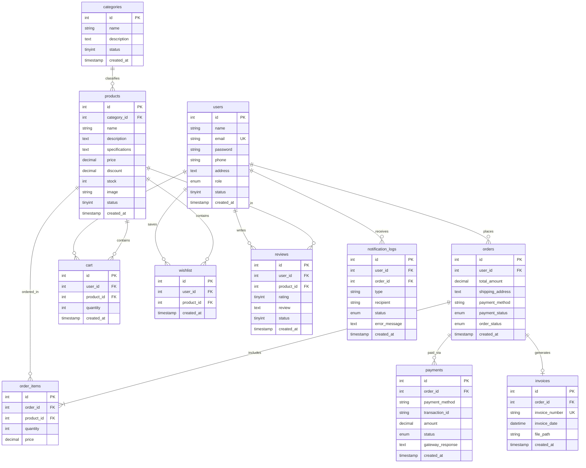

# Database Design Specification

## 1. Database Overview
- **Database Name:** `ecommerce_db`
- **Character Set:** `utf8mb4`
- **Collation:** `utf8mb4_unicode_ci`
- **Engine:** InnoDB (ACID Compliant)

---

## 2. Entity-Relationship (ER) Diagram

---

## 3. Data Dictionary

### 3.1 `users`
Stores customer and administrator profile credentials and metadata.
- `id`: INT AUTO_INCREMENT PRIMARY KEY
- `name`: VARCHAR(100) NOT NULL
- `email`: VARCHAR(150) NOT NULL UNIQUE
- `password`: VARCHAR(255) NOT NULL (bcrypt hash)
- `phone`: VARCHAR(20) NULL
- `address`: TEXT NULL
- `role`: ENUM('customer', 'admin') DEFAULT 'customer'
- `status`: TINYINT(1) DEFAULT 1
- `created_at`: TIMESTAMP DEFAULT CURRENT_TIMESTAMP
- `updated_at`: TIMESTAMP ON UPDATE CURRENT_TIMESTAMP

### 3.2 `categories`
Stores product categories and catalog hierarchy.
- `id`: INT AUTO_INCREMENT PRIMARY KEY
- `name`: VARCHAR(100) NOT NULL
- `description`: TEXT NULL
- `status`: TINYINT(1) DEFAULT 1

### 3.3 `products`
Stores inventory stock, pricing, and catalog attributes.
- `id`: INT AUTO_INCREMENT PRIMARY KEY
- `category_id`: INT NOT NULL (FK -> `categories.id` ON DELETE RESTRICT ON UPDATE CASCADE)
- `name`: VARCHAR(200) NOT NULL
- `description`: TEXT NULL
- `specifications`: TEXT NULL
- `price`: DECIMAL(10,2) NOT NULL
- `discount`: DECIMAL(5,2) DEFAULT 0.00
- `stock`: INT DEFAULT 0
- `image`: VARCHAR(255) NULL
- `status`: TINYINT(1) DEFAULT 1 (Used for soft deletion)

### 3.4 `cart`
Active shopping cart items per authenticated customer.
- `id`: INT AUTO_INCREMENT PRIMARY KEY
- `user_id`: INT NOT NULL (FK -> `users.id` ON DELETE CASCADE)
- `product_id`: INT NOT NULL (FK -> `products.id` ON DELETE CASCADE)
- `quantity`: INT NOT NULL DEFAULT 1
- `UNIQUE KEY unique_user_product (user_id, product_id)`

### 3.5 `wishlist`
Products bookmarked by customers.
- `id`: INT AUTO_INCREMENT PRIMARY KEY
- `user_id`: INT NOT NULL (FK -> `users.id` ON DELETE CASCADE)
- `product_id`: INT NOT NULL (FK -> `products.id` ON DELETE CASCADE)
- `UNIQUE KEY unique_wishlist_product (user_id, product_id)`

### 3.6 `orders`
Master order headers.
- `id`: INT AUTO_INCREMENT PRIMARY KEY
- `user_id`: INT NOT NULL (FK -> `users.id` ON DELETE RESTRICT)
- `total_amount`: DECIMAL(10,2) NOT NULL
- `shipping_address`: TEXT NOT NULL
- `payment_method`: VARCHAR(50) NOT NULL ('Cash on Delivery', 'Online Payment')
- `payment_status`: ENUM('pending', 'paid', 'failed', 'refunded') DEFAULT 'pending'
- `order_status`: ENUM('pending', 'confirmed', 'packed', 'shipped', 'delivered', 'cancelled') DEFAULT 'pending'

### 3.7 `order_items`
Snapshot lines of products purchased within an order.
- `id`: INT AUTO_INCREMENT PRIMARY KEY
- `order_id`: INT NOT NULL (FK -> `orders.id` ON DELETE CASCADE)
- `product_id`: INT NOT NULL (FK -> `products.id` ON DELETE RESTRICT)
- `quantity`: INT NOT NULL
- `price`: DECIMAL(10,2) NOT NULL (Purchase-time price snapshot)

### 3.8 `reviews`
Verified customer ratings and reviews.
- `id`: INT AUTO_INCREMENT PRIMARY KEY
- `user_id`: INT NOT NULL (FK -> `users.id` ON DELETE CASCADE)
- `product_id`: INT NOT NULL (FK -> `products.id` ON DELETE CASCADE)
- `rating`: TINYINT NOT NULL (CHECK rating >= 1 AND rating <= 5)
- `review`: TEXT NULL
- `UNIQUE KEY unique_user_product_review (user_id, product_id)`

### 3.9 `payments`
Transactions and gateway audit trail.
- `id`: INT AUTO_INCREMENT PRIMARY KEY
- `order_id`: INT NOT NULL (FK -> `orders.id` ON DELETE RESTRICT)
- `payment_method`: VARCHAR(50) NOT NULL
- `transaction_id`: VARCHAR(255) NULL
- `amount`: DECIMAL(10,2) NOT NULL
- `status`: ENUM('pending', 'paid', 'failed', 'refunded') DEFAULT 'pending'
- `gateway_response`: TEXT NULL

### 3.10 `invoices`
Formal tax invoices generated per order.
- `id`: INT AUTO_INCREMENT PRIMARY KEY
- `order_id`: INT NOT NULL UNIQUE (FK -> `orders.id` ON DELETE RESTRICT)
- `invoice_number`: VARCHAR(50) NOT NULL UNIQUE
- `invoice_date`: DATETIME DEFAULT CURRENT_TIMESTAMP
- `file_path`: VARCHAR(255) NULL

### 3.11 `notification_logs`
Dispatched communication audit records.
- `id`: INT AUTO_INCREMENT PRIMARY KEY
- `user_id`: INT NULL (FK -> `users.id` ON DELETE SET NULL)
- `order_id`: INT NULL (FK -> `orders.id` ON DELETE SET NULL)
- `type`: VARCHAR(100) NOT NULL
- `recipient`: VARCHAR(150) NULL
- `status`: ENUM('sent', 'failed') DEFAULT 'sent'
- `error_message`: TEXT NULL

---

## 4. Index Optimization Strategy
- `idx_products_category` on `products(category_id)`: Accelerates category catalog queries.
- `idx_products_status` on `products(status)`: Filters inactive or soft-deleted items efficiently.
- `idx_orders_user` on `orders(user_id)`: Optimizes customer order history page lookup.
- `idx_orders_status` on `orders(order_status)`: Improves admin order filtering.
- `idx_reviews_product` on `reviews(product_id)`: Fast product review aggregates.
