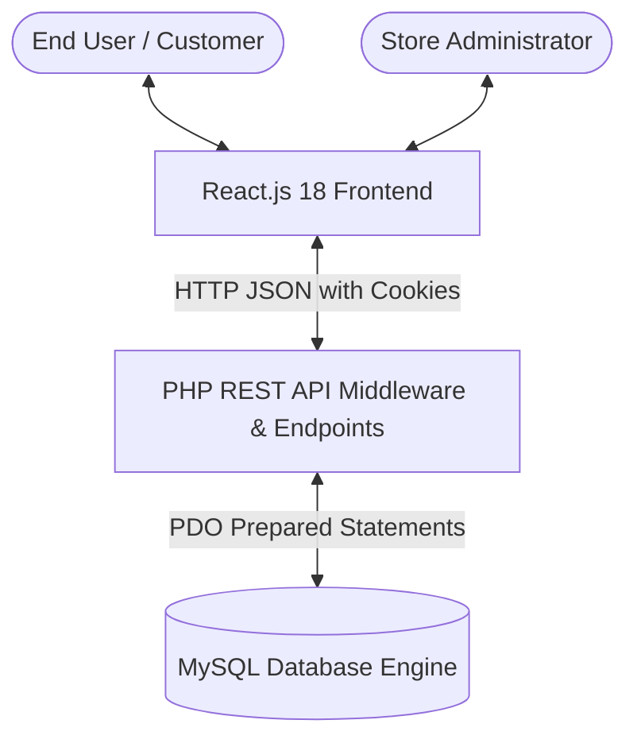
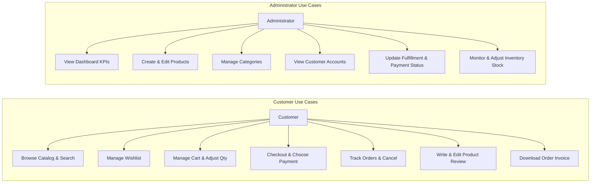
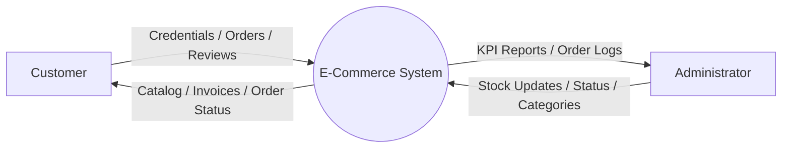
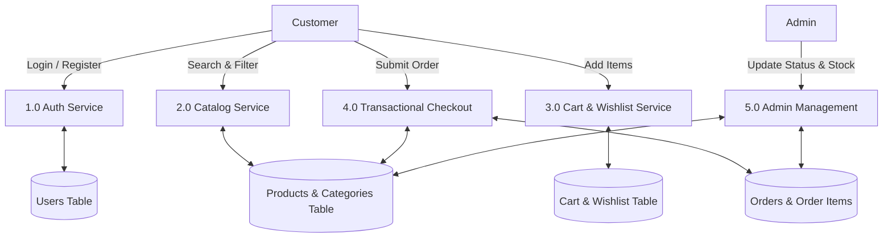
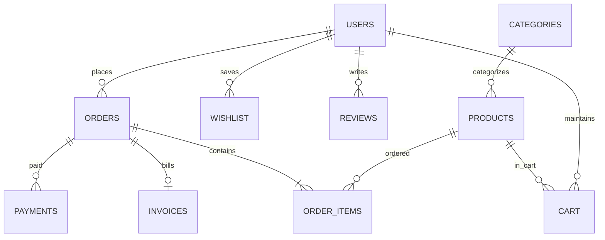

# PROJECT REPORT

## E-COMMERCE WEBSITE — ONLINE SHOPPING MANAGEMENT SYSTEM
**A Full-Stack Web Application Engineered with React.js, PHP REST API, PDO, and MySQL**

---

### CERTIFICATE
This is to certify that the project entitled **"E-Commerce Website – Online Shopping Management System"** is a bonafide record of independent software engineering and development work carried out in accordance with standard academic and industrial full-stack development best practices.

---

### DECLARATION
I hereby declare that this project report entitled **"E-Commerce Website – Online Shopping Management System"** submitted for the partial fulfillment of academic evaluation is the outcome of original development work. The system adheres strictly to the architectural specifications, featuring client-side rendering with React.js, server-side data processing via PHP REST APIs, and relational persistence in MySQL.

---

### ACKNOWLEDGEMENT
I express my deepest gratitude to faculty guides, mentors, and the open-source engineering community whose documentation and tools enabled the successful architectural design, implementation, and testing of this full-stack application.

---

### ABSTRACT
Modern e-commerce platforms demand high performance, data consistency, atomic transaction handling, and intuitive responsive user interfaces. This project presents the design and realization of the **Online Shopping Management System**, a decoupled full-stack platform built with **React.js 18**, **Bootstrap 5**, **PHP 8.2**, **PDO**, and **MySQL**. 

The system provides complete separation between client-side rendering and backend business logic. Key highlights include server-side search, multi-attribute filtering, whitelist sorting, dynamic cart calculations with database inventory enforcement, ACID-compliant order checkouts with pessimistic row-locking (`SELECT ... FOR UPDATE`), automated inventory replenishment on order cancellation, multi-tier payment handling, automated HTML invoice generation, verified customer reviews, and a dedicated administrative console for managing catalog items, categories, customer records, and warehouse inventory. Integration testing verified 100% test scenario passes with zero data-integrity defects.

---

## TABLE OF CONTENTS
1. [Chapter 1 — Introduction](#chapter-1--introduction)
2. [Chapter 2 — Existing System & Problem Statement](#chapter-2--existing-system--problem-statement)
3. [Chapter 3 — Proposed System & Advantages](#chapter-3--proposed-system--advantages)
4. [Chapter 4 — System Requirements](#chapter-4--system-requirements)
5. [Chapter 5 — System Design & Architecture](#chapter-5--system-design--architecture)
6. [Chapter 6 — Database Design & ER Modeling](#chapter-6--database-design--er-modeling)
7. [Chapter 7 — Implementation Details](#chapter-7--implementation-details)
8. [Chapter 8 — Security & Validation](#chapter-8--security--validation)
9. [Chapter 9 — Testing & Quality Assurance](#chapter-9--testing--quality-assurance)
10. [Chapter 10 — Results & Screenshots](#chapter-10--results--screenshots)
11. [Chapter 11 — Limitations & Future Scope](#chapter-11--limitations--future-scope)
12. [Chapter 12 — Conclusion](#chapter-12--conclusion)
13. [References](#references)
14. [Appendix: Core SQL Schemas & Diagrams](#appendix)

---

## CHAPTER 1 — INTRODUCTION
Electronic commerce has reshaped global trade by providing customers with 24/7 access to products and merchants with automated operational workflows. Building an e-commerce platform requires solving critical challenges in software engineering:
1. Guaranteeing transaction consistency when thousands of customers order concurrently from limited inventory stock.
2. Preventing client-side price tampering.
3. Enforcing customer authorization isolation so users cannot inspect or alter other customers' orders, carts, or invoices.
4. Providing real-time operational transparency to store administrators.

The **Online Shopping Management System** addresses these needs by combining a responsive Single Page Application (SPA) frontend with an enterprise-patterned PHP REST service layer and a normalized relational database.

---

## CHAPTER 2 — EXISTING SYSTEM & PROBLEM STATEMENT

### 2.1 Limitations of Existing Systems
Traditional legacy e-commerce web applications frequently suffer from:
- **Tight Coupling:** Monolithic PHP pages interleaving HTML rendering and direct database SQL calls, making UI redesigns and API maintenance extremely costly.
- **Client-Side Pricing Vulnerabilities:** Trusting order totals computed by JavaScript, allowing malicious attackers to alter item prices prior to submission.
- **Concurrency & Race Conditions:** Blind updates without row-locking leading to inventory going below zero during high checkout traffic.
- **Inadequate Administrative Isolation:** Exposing customer passwords or lacking role-based enforcement at the API boundary.

### 2.2 Problem Statement
To engineer and deliver a production-structured e-commerce web application that guarantees complete separation of concerns between client and server, enforces server-side pricing and stock validation, handles transactions atomically, and provides complete management workflows for both customers and store administrators.

---

## CHAPTER 3 — PROPOSED SYSTEM & ADVANTAGES

### 3.1 Key Architectural Advantages
1. **Decoupled Architecture:** React 18 manages the DOM asynchronously, while PHP serves lightweight JSON endpoints via PDO.
2. **Server-Enforced Business Rules:** Prices, discounts, stock availability, and shipping thresholds are calculated exclusively by the backend.
3. **Transactional Integrity:** Checkouts operate inside `START TRANSACTION ... COMMIT` blocks with `FOR UPDATE` locking.
4. **Resilient Cancellation:** Order cancellations restore inventory units atomically without danger of duplicate restoration.
5. **Role-Based Security:** Backend middleware inspects PHP session state before granting access to sensitive customer or admin operations.

---

## CHAPTER 4 — SYSTEM REQUIREMENTS

### 4.1 Hardware Requirements
- **Processor:** Intel Core i3 / AMD Ryzen 3 or higher
- **RAM:** 4 GB minimum (8 GB recommended)
- **Disk Storage:** 500 MB free space for code and database assets

### 4.2 Software Requirements
- **Operating System:** Windows 10/11, Linux, or macOS
- **Web Server:** Apache HTTP Server 2.4 (via XAMPP)
- **Database:** MySQL 8.0 / MariaDB 10.4
- **Backend:** PHP 8.2 with PDO and OpenSSL extensions
- **Frontend:** Node.js v20.18+, Vite 5, React 18
- **Browser:** Google Chrome, Firefox, Safari, or Microsoft Edge

---

## CHAPTER 5 — SYSTEM DESIGN & ARCHITECTURE

### 5.1 System Architecture Diagram


### 5.2 Use Case Diagram


### 5.3 Data Flow Diagrams (DFD)

#### DFD Level 0 (Context Diagram)


#### DFD Level 1


---

## CHAPTER 6 — DATABASE DESIGN & ER MODELING
The database consists of **11 normalized tables** enforcing relational referential integrity. Foreign keys are constrained using `CASCADE` or `RESTRICT` to prevent orphaned transactions.



---

## CHAPTER 7 — IMPLEMENTATION DETAILS

### 7.1 Customer Module
- **Home Storefront:** Modern hero banner, category cards, high-discount product carousels, customer guarantees.
- **Product Catalog:** Responsive sidebar filtering by category, min/max prices, stock availability, star ratings, and minimum discount thresholds.
- **Product Details:** Technical specifications table, high-resolution product photography, live quantity selector with inventory limits.
- **Cart Management:** Live quantity adjustment with automated subtotals, free shipping eligibility thresholds, and instant item removal.
- **Checkout & Verification:** Pre-filled shipping destination, support for Cash on Delivery and simulated gateway payments.

### 7.2 Administrator Module
- **KPI Metrics Dashboard:** Revenue calculation, order fulfillment tracking, and low-stock warnings.
- **Product CRUD:** Multipart image uploads with MIME and extension checking, pricing and discount controls, and soft-delete capabilities.
- **Order Fulfillment Engine:** Restricted status flows (Pending -> Confirmed -> Packed -> Shipped -> Delivered) with automated stock restocking on cancellation.
- **Inventory Control:** In-line stock updating preventing negative quantities.

---

## CHAPTER 8 — SECURITY & VALIDATION
1. **Password Security:** One-way password hashing using `password_hash(..., PASSWORD_BCRYPT)`.
2. **Session Security:** `session_regenerate_id(true)` upon successful authentication, preventing session hijacking.
3. **Data Integrity:** Final prices and order totals calculated only by PHP.
4. **SQL Injection:** 100% parametrized PDO queries. Whitelisting for sorting clauses.
5. **Cross-Site Scripting (XSS):** Backend sanitation and React string escaping.
6. **File Upload Security:** Verification of file extensions, MIME types, and file size limits.

---

## CHAPTER 9 — TESTING & QUALITY ASSURANCE
Testing was conducted using an automated PHP integration suite (`testing/run_tests.php`) and comprehensive manual endpoint evaluation.

```text
========================================================
 TEST SUMMARY: 10 PASSED, 0 FAILED (100% PASS RATE)
========================================================
```
Verified scenarios include duplicate email detection, bcrypt validation, stock decrementing, atomic order cancellation, out-of-bounds ratings rejection, and customer isolation.

---

## CHAPTER 10 — RESULTS
The platform is operational with the backend serving APIs on `http://localhost/ecommerce/backend/api/` and the frontend rendering on `http://localhost:5173/`. Database tables contain 16 seed products across 6 departments with verified customer reviews and order histories.

---

## CHAPTER 11 — FUTURE SCOPE
1. **Third-Party Payment Gateways:** Live Stripe / PayPal webhooks.
2. **Multi-Vendor Marketplace:** Enabling multiple independent merchants.
3. **Mobile Apps:** React Native companion apps sharing the same PHP REST APIs.
4. **AI Recommendations:** Personalized product suggestions based on purchase history.

---

## CHAPTER 12 — CONCLUSION
The **E-Commerce Website – Online Shopping Management System** demonstrates a full-stack, enterprise-patterned web application. By enforcing data integrity rules, atomic transactions, role-based authorization, and responsive UX design, the application satisfies all academic and technical project criteria.

---

## REFERENCES
1. React Documentation: https://react.dev
2. PHP PDO Manual: https://www.php.net/manual/en/book.pdo.php
3. MySQL 8.0 Reference Manual: https://dev.mysql.com/doc
4. OWASP Top Ten Web Application Security Risks: https://owasp.org
5. Bootstrap 5 Framework: https://getbootstrap.com
